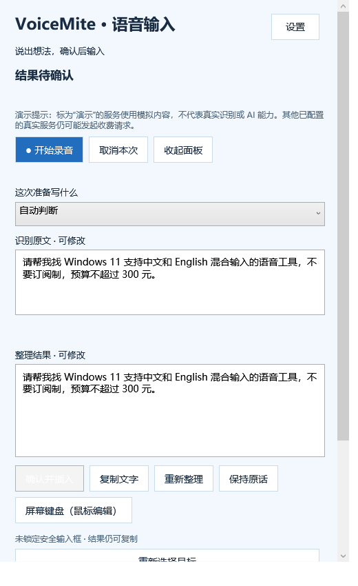

# VoiceMite：鼠标操控的智能语音输入助手

[下载 Windows 安装版](https://github.com/cynic004/VoiceMite/releases/latest) · [查看源码](https://github.com/cynic004/VoiceMite) · [反馈问题](https://github.com/cynic004/VoiceMite/issues/new/choose)

[](https://github.com/cynic004/VoiceMite/actions/workflows/ci.yml)

VoiceMite 是 Windows x64 桌面程序，使用鼠标开始、停止和取消录音，将语音转成文字并按场景整理，确认后插入原输入位置或手动复制。源码、自动化检查、便携包和当前用户安装程序随项目交付。

当前版本：**0.1.0，最小可用版本**。它优先保证“确认后才插入”和“无法验证时保留文字”。不自动搜索、不发送消息、不提交表单、不执行提示词或命令。

> 当前真实接口需要自行填写 API 密钥。演示模式使用预设样例，**不是语音识别**；不能用演示结果证明麦克风语音已被正确识别。真实中文录音 → 云端转写 → 云端整理的质量，在没有真实服务密钥和实际中文发声测试前仍属未验证。逐项结果见 [测试报告](docs/TEST-REPORT.md)。

<details>
<summary>查看当前中文界面（演示文字）</summary>



</details>

## 安装、升级和卸载

首次下载请打开 [GitHub Releases](https://github.com/cynic004/VoiceMite/releases/latest)，选择 `VoiceMite-Setup-0.1.0-x64.exe`；不想安装可选择 `VoiceMite-0.1.0-win-x64-portable.zip`。以下 `artifacts/` 路径指自行构建后的本地文件，安装包不保存在 Git 源码历史中。

目标运行环境为 Windows 10 2004（19041）及更新版本、Windows 11，x64；本次实测 Windows 11。Windows 桌面功能的实际测试范围以测试报告为准，Windows 10 未实测；未测试过的应用和输入框不保证兼容。

- 安装版：运行 `artifacts/VoiceMite-Setup-0.1.0-x64.exe`，选择中文或英文，安装到当前用户目录。默认位置为 `%LOCALAPPDATA%\Programs\VoiceMite`，不请求管理员权限，不默认开机启动，也不会在安装结束后自动录音。
- 便携版：将 `artifacts/VoiceMite-0.1.0-win-x64-portable.zip` 解压到可写目录，运行 `VoiceMite.exe`。已包含 .NET 桌面运行库，无需另装 .NET；设置仍保存在当前用户数据目录，不跟随 ZIP 文件。
- 升级：先从系统托盘退出 VoiceMite，再运行新版安装程序。稳定的安装标识和目录允许覆盖升级，用户设置、加密密钥和偏好保留。同版本重装及数据保留已实测；安装程序不会自动关闭同步软件或其他用户应用。当前只有 0.1.0，跨版本数据迁移尚无实际升级样本。
- 卸载：从 Windows“设置 → 应用 → 安装的应用”卸载 VoiceMite。默认保留个人设置、密钥和偏好；交互卸载时可以明确选择同时删除主配置目录。静默卸载始终保留个人数据。便携版退出程序后删除解压目录即可；如需清除个人数据，先在应用中删除密钥与偏好，或自行删除 `%LOCALAPPDATA%\VoiceMite`。开发演示目录 `%LOCALAPPDATA%\VoiceMite-Demo` 独立保留，如不再需要可自行删除。

发布包和安装程序**未进行代码签名**。Windows 可能提示未知发布者。请检查来源及 `artifacts/SHA256SUMS.txt`；不需要关闭杀毒软件、防火墙、SmartScreen 或其他系统防护。

完整源码压缩包为 `artifacts/VoiceMite-0.1.0-source.zip`，不包含开发工具、编译缓存或用户设置/密钥。

### 从旧名 VoiceInk 升级

VoiceMite 是本项目的正式名称。改名保留旧版安装标识：升级会继续使用原安装目录，清理旧名称的程序文件和快捷方式，不移动或合并个人设置。新用户默认使用 `%LOCALAPPDATA%\VoiceMite`；如果该目录不存在且已有 `%LOCALAPPDATA%\VoiceInk`，程序会直接使用原配置与加密密钥。两个目录同时存在时优先使用 VoiceMite，不将损坏的新配置静默替换为旧服务配置。演示目录按同样规则独立选择，不混用真实配置。

卸载时默认保留数据；若明确选择删除，提示会说明同时删除正式配置及兼容的旧 VoiceInk 配置。升级和静默卸载均不删除这些配置。演示目录单独保留。

## 第一次使用

1. 启动后阅读数据流说明。先选择界面语言，配置 STT（语音转写）和 LLM（文字整理），或保留演示模式试用界面。
2. 在设置中选择麦克风。Windows 的“设置 → 隐私和安全性 → 麦克风”必须允许桌面应用访问麦克风；程序不会自动更改系统权限。
3. 用鼠标点击目标输入框，将光标放好或选中要替换的文字。点击浅蓝色悬浮图标开始录音，再点一次停止；面板也提供停止与取消按钮。
4. 录音时可见时长和音量反馈。本版本真实 STT 不提供边说边转写，因此会明确显示“停止后生成文字”。
5. 停止后查看原始转写和整理结果。可以选择模式、编辑、重新整理；有重大歧义时通过鼠标按钮选择。选择原文或只转写时不调用文字模型。
6. 确认文字后点击插入。只有原目标与输入位置可验证时才尝试插入；若目标改变或不兼容，保留结果供复制。复制后由用户自行粘贴，不会自动发送。

需要改选输入框时，点击“重新选择目标”，面板会收起。用鼠标点击目标输入框、放好光标，再点击带确认标记的悬浮图标记录目标；面板重新展开后点击确认插入。这个过程没有倒计时，也不会开始录音。修改文字或填写 API 配置时可点击“屏幕键盘”，用鼠标操作 Windows 自带键盘；也可以重新录音。屏幕键盘只在主动点击时打开，不自动输入或提交。

所有核心操作都可用鼠标完成。悬浮图标可以拖动，位置会记住；托盘菜单提供返回面板、设置与退出。没有默认全局快捷键或鼠标侧键拦截。

开发演示命令 `VoiceMite.exe --demo` 使用独立的 `%LOCALAPPDATA%\VoiceMite-Demo` 设置目录，不覆盖真实服务配置；演示仍不代表真实识别。

## API 配置

STT 和 LLM 独立配置，可以使用不同主机、模型和密钥。界面语言、识别语言和输出语言分别设置。切换界面语言即时生效并保存；只转写与原文模式保留转写语言，不为翻译额外调用 LLM。

| 设置 | STT 语音转写 | LLM 文字整理 |
| --- | --- | --- |
| 实现协议 | `POST {BaseUrl}/audio/transcriptions` | `POST {BaseUrl}/chat/completions` |
| 请求 | Bearer 密钥；multipart WAV 文件；`model`、`language`、`response_format=json` | Bearer 密钥；JSON 消息；JSON object 输出 |
| 必要能力 | 接收 PCM WAV 的音频转写接口 | 支持 Chat Completions 及 JSON object 输出的文字模型 |
| 初始模型字段 | `whisper-1` | `gpt-4o-mini` |
| 默认基础地址 | `https://api.openai.com/v1/` | `https://api.openai.com/v1/` |
| 实时能力 | 当前实现为停止后的单次请求，不支持实时流式识别 | 当前为单次整理，不向外执行任何工具 |

模型名称是可修改的配置初值，**不代表该模型在你的账户、地区或服务商必然可用**。第三方服务必须真正实现上面的音频/文字接口和格式，不能因为“聊天接口能通”就认为支持音频。没有实现 Azure 专用鉴权、厂商私有协议、Realtime WebSocket 或任意“OpenAI 兼容”接口自动适配。

地址必须为 HTTPS，不接受含用户名、密码、查询参数或片段的地址。保留正常系统证书验证，不自动跟随重定向，防止密钥被带到其他主机。请自己核实服务商及数据处理政策。更改地址后，原密钥不会自动变为新服务的有效凭据。

两个连接测试独立进行。连接测试会向对应服务发送小额测试请求，可能产生服务商费用；它不是零费用的本地连通性检查。STT 测试使用合成的短静音 WAV，不会偷偷打开麦克风；静音测试不能证明真实中文识别质量。

请求超时可设 5–120 秒，默认 60 秒；没有自动重试。每段录音最长 120 秒、WAV 最大 4 MiB，转写或整理文字最多 16,000 个字符，响应最大 256 KiB。错误后保留可用文字，取消或新任务会使旧响应失效。网络取消是尽力而为，已经抵达服务端的请求仍可能计费。

## 五种输入模式

| 模式 | 行为 |
| --- | --- |
| 自动 | 根据本次转写判断场景，明显歧义时询问；不靠应用名称武断分类 |
| 原文 | 保留转写结果，不调用 LLM，不擅自翻译或重写 |
| 搜索 | 整理成搜索问题或关键词，保留限定条件，不自动打开搜索 |
| 聊天 | 整理自然消息，要求保留原意，不擅自加事实、承诺、情绪或称呼 |
| AI 提示词 | 整理目标、背景、要求和输出，缺少信息时标明或询问，不执行任务 |

LLM 仍可能出错。请特别核对否定词、金额、数字、日期、人名和专有术语；程序不会在未经确认时自动插入结果。

## 安全插入和剪贴板

程序记录原窗口、进程和可识别的编辑控件，使用本地选区/内容指纹检测变化。UI Automation 的 TextPattern 仅用于检查，不充当文字写入接口；不使用 ValuePattern 整体赋值来假装光标插入，不全选覆盖、不猜测退格数量。

插入前重新检查目标存在、编辑能力、焦点、内容和选区。密码框、终端、命令窗口、权限更高或无法确认的目标会被拒绝；不绕过 UAC 或安全桌面。目标切换、移动光标、关闭窗口或失去验证能力后，应重新选择目标或手动复制。

兼容插入使用 Windows 剪贴板与一次粘贴操作。面板会告知使用剪贴板；能安全保存时保留原有剪贴板内容，并结合剪贴板序列号检查用户是否复制了新内容，不用旧内容覆盖用户的新复制。无法可靠备份或验证时停止自动插入。结果不确定时不自动重试，避免重复文字。

系统剪贴板历史、云同步、第三方剪贴板工具和目标应用可能留存复制或粘贴的文字。程序不能撤回这些系统或外部副本。多行内容作为文本粘贴，不模拟 Enter、发送、搜索、提交或执行快捷键。

## 隐私与语言习惯

- 只在点击开始后录音，待机不监听；停止、取消、退出后释放录音设备。音频仅在内存中临时存在，不默认写入音频文件或完整历史。
- 音频发送给已配置的 STT；转写文字和启用的少量偏好发送给已配置的 LLM。本地桌面程序**不等于全部本地处理**。
- 默认不截图，不读取屏幕、浏览历史、其他聊天窗口或其他软件全部输入。本版本不收集外部应用上下文，也不把目标输入框的检查指纹发送到模型。
- 语音及文档内容是待整理数据，不是程序权限或操作指令。模型没有调用系统命令、读取其他窗口、改设置或发消息的工具。
- 密钥采用当前 Windows 用户范围的 DPAPI 加密，分别保存为 `%LOCALAPPDATA%\VoiceMite\secrets\stt.dpapi`、`llm.dpapi`。普通设置、日志、源码和发布包不包含明文密钥。可以分别更换或删除密钥。
- 语言习惯学习默认关闭。仅从本工具中用户确认的文字提取简短可解释的标点/长度偏好；不自动保存原始对话、密码、健康或财务内容。偏好可查看、编辑、暂停及删除，保存在本地 `preferences.json`。用户本次要求优先于偏好。
- 当前真实协议没有实时转写，因此不发起录音中的实时摘要请求，也不假装实时理解。没有额外摘要的后台循环；演示文字始终应明确标为演示。

## 构建、测试与发布

开发依赖：Windows x64、**PowerShell 7+**、.NET SDK **10.0.403**（`global.json` 允许更新的 `10.0.4xx` 补丁）；WPF、UI Automation、Win32/winmm、DPAPI 和系统托盘均使用系统/.NET 接口，应用项目没有第三方 NuGet 包。发布安装程序另需 **Inno Setup 7.1.1 x64**。当前自包含运行库为 .NET / Windows Desktop **10.0.14**，可在发布包 `BUILD-INFO.json` 及对应 `.runtimeconfig.json` 核对。

在项目根目录使用 PowerShell：

```powershell
pwsh -File tools/build.ps1
pwsh -File tools/test.ps1
pwsh -File tools/publish.ps1
```

脚本优先查找 `%LOCALAPPDATA%\VoiceInkDev\dotnet\dotnet.exe`，其次查找系统 .NET 10 SDK。可用 `-DotNetPath '完整路径\dotnet.exe'` 指定。安装程序编译器默认查找 `.tools\inno\ISCC.exe` 或系统 Inno Setup；也可用 `-InnoCompilerPath '完整路径\ISCC.exe'` 指定，或 `-SkipInstaller` 仅制作便携包。

`test.ps1` 执行无需额外测试框架包的自动化测试程序，失败返回非零退出码。Windows 真机交互检查与核心逻辑测试分开记录，不用模拟数据冒充真实语音或浏览器验证。

`tools/test.ps1 -Windows` 额外运行 Windows 工作线程隔离测试（模拟目标）及原生桌面测试（真实控件、剪贴板与短时麦克风录制）；`-External` 额外打开隔离 Edge 本地测试页及一个新的记事本测试文件。运行这些选项时请暂停其他鼠标/剪贴板操作。测试不发送录音至服务。核心默认测试不打开麦克风。不同测试范围的结果分开写在 `docs/evidence`。

`tools/test.ps1 -Ui` 在退出其他 VoiceMite 实例后运行 11 项控制器/双语界面检查，输出 `artifacts/ui-smoke`。它只渲染应用自身的 WPF 窗口，不抓取整个桌面，不录音、不访问 API。便携版也可直接运行 `VoiceMite.exe --ui-smoke 输出目录` 验证自包含运行库启动。

`tools/test.ps1 -Target` 构建独立 WPF 测试框，使用真实鼠标点击悬浮图标，验证不抢焦点、无倒计时重新选择、实际工作线程捕获与确认插入，共 10 项；结果写入 `artifacts/target-smoke`。这项测试会移动鼠标并使用剪贴板，请不要同时操作电脑，不录音、不调用 API。

`tools/smoke-install.ps1 -Ui` 对安装包进行隔离目录安装、同版本重装、安装后的自包含界面启动检查及卸载；如已有正式安装或应用仍在运行则停止，不覆盖现有安装。测试默认保留个人数据，仅删除自己创建的数据保留标记；无录音和 API 请求。

目录：

```text
src/VoiceMite.Core       配置、协议、场景整理、请求取消与状态隔离
src/VoiceMite.Windows    录音、DPAPI、安全目标和剪贴板插入
src/VoiceMite.App        中英文 WPF 界面、悬浮图标、托盘与设置
tests/VoiceMite.Tests    核心自动化测试
tools                  构建、测试、发布和 Inno 安装程序定义
docs                   架构、实际测试结果与第三方说明
artifacts              本机生成的 Windows x64 发布产物及校验值
```

## 常见问题

**“为什么说了话却总出现同一段文字？”** 当前 STT 可能处于演示模式。切换到真实协议、填写密钥并测试连接。演示不识别麦克风内容。

**“录音时为什么没有文字？”** 当前真实 STT 是非流式协议，停止录音后才发送并生成文字；时长和音量只是本地录音反馈。

**“连接成功，为什么识别失败？”** 检查 STT 是否真正支持 WAV 转写、模型是否支持中文、账户余额、大小上限及服务商错误。LLM 连接成功不能证明音频接口可用。

**“为什么不能插入？”** 控件可能不提供足够的 UI Automation 信息，或者目标焦点、内容、光标、选区、窗口权限发生变化。保留文字并手动复制；不要为了插入而给程序管理员权限。

**“可以帮我按发送吗？”** 不会。准备文字后由用户自己决定发送、搜索或提交。

**“中文界面能输出英文吗？”** 可分别设置界面语言、识别语言与 LLM 输出语言。只转写/原文模式不经过 LLM，保留识别文字本身。

**“切换显示器或缩放后图标丢失？”** 通过托盘入口返回面板。多显示器、不同 DPI、休眠恢复的实测范围见测试报告。

**“服务返回错误会显示密钥吗？”** 程序使用本地化错误类型，不直接显示服务端原始响应或异常详情。报告问题时也请勿附上密钥。

## 协议与工具来源

实现依据：[OpenAI 音频转写协议](https://developers.openai.com/api/reference/resources/audio/subresources/transcriptions/methods/create)、[结构化 JSON 输出](https://developers.openai.com/api/docs/guides/structured-outputs?api-mode=chat)、[Microsoft UI Automation TextPattern 说明](https://learn.microsoft.com/en-us/dotnet/framework/ui-automation/ui-automation-textpattern-overview)、[Inno Setup 非管理员安装](https://jrsoftware.org/ishelp/topic_setup_privilegesrequired.htm)。协议文档说明不等于本账户真实请求已经通过，实际验证结果仅以测试报告为准。

## 维护与贡献

推送或提交 PR 后，GitHub Actions 会构建 Windows 程序并执行不依赖真实服务的核心与工作线程检查。桌面录音、剪贴板、记事本/浏览器和安装测试由维护者明确运行，不用云端模拟结果替代真机验收。安装包放在 Releases，源码历史不保存大型构建产物。

[贡献与验证步骤](CONTRIBUTING.md) · [维护和发布流程](docs/MAINTENANCE.md) · [更新记录](CHANGELOG.md) · [安全报告](SECURITY.md)
